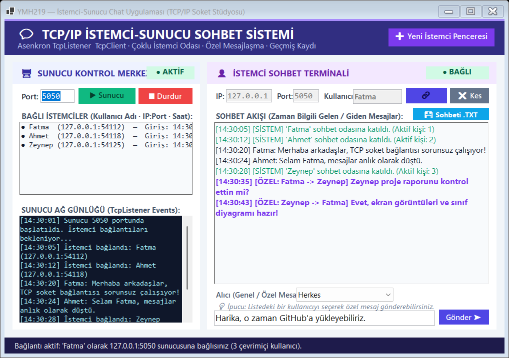
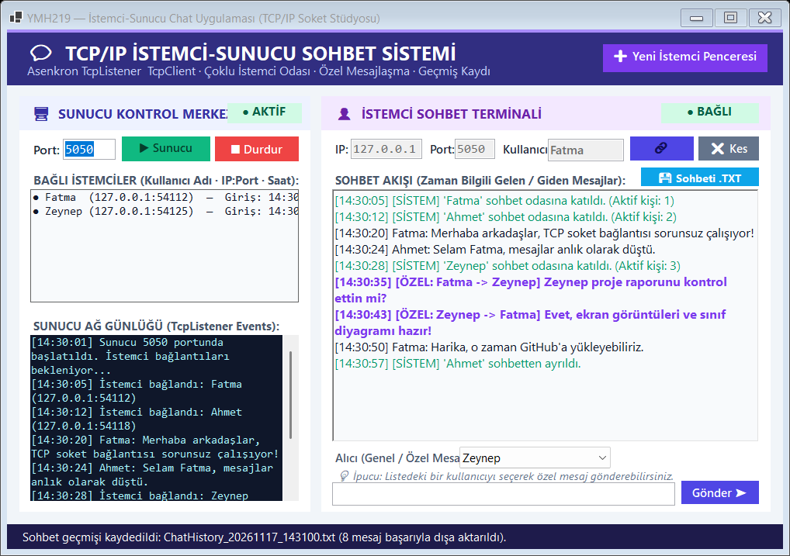

# 💬 YMH219 — İstemci-Sunucu Chat Uygulaması (TCP/IP Soket Stüdyosu)

> **Nesne Tabanlı Programlama (YMH 219)** dersi kapsamında C# ve Windows Forms kullanılarak geliştirilmiş, **Indigo Messenger** arayüz tasarımına sahip asenkron TCP/IP istemci-sunucu sohbet sistemi.

---

## 📌 Proje Adı ve Kısa Açıklama

**YMH219-ChatApp**, yerel ağda (LAN) veya aynı bilgisayar üzerinde (`127.0.0.1`) birden fazla uygulama örneğinin TCP/IP soketleri (`TcpListener` ve `TcpClient`) üzerinden gerçek zamanlı mesajlaşmasını sağlayan nesne tabanlı bir masaüstü sohbet uygulamasıdır.

Ağ iletişimi `NetworkStream`, `StreamReader` ve `StreamWriter` sınıflarıyla asenkron (`async` / `await`) olarak kurgulanmış; arayüz iş parçacığı (`UI Thread`) kilitlenmeden eş zamanlı mesaj ve bağlı istemci güncellemeleri gerçekleştirilmiştir.

---

## 🛠️ Kullanılan Teknoloji / NuGet Paketleri

| Bileşen | Detay |
| :--- | :--- |
| **Programlama Dili** | C# 12 |
| **Çatkı (Framework)** | .NET (`net10.0-windows` / Windows Forms) |
| **Ağ İletişimi** | `System.Net.Sockets` (`TcpListener`, `TcpClient`, `NetworkStream`) |
| **Veri Akışı & Eşzamanlılık** | `StreamReader` / `StreamWriter` (UTF-8), `Task` (`async` / `await`), `ConcurrentDictionary` |
| **Harici NuGet Paketi** | Harici paket gerektirmez (Standart .NET Windows Desktop SDK ile çalışır) |

---

## 🚀 Kurulum ve Çalıştırma Adımları

1. **Depoyu klonlayın:**
   ```bash
   git clone https://github.com/fatmaturkmen244-spec/YMH219-ChatApp.git
   cd YMH219-ChatApp
   ```
2. **Visual Studio ile çalıştırma:**
   - `YMH219-ChatApp.sln` çözüm dosyasını **Visual Studio 2022** (veya üzeri) ile açın ve `F5` ile başlatın.
3. **Komut satırı (.NET CLI) ile çalıştırma:**
   ```bash
   dotnet run --project ChatApp/ChatApp.csproj
   ```
4. **Tek Bilgisayarda Çoklu İstemci Testi:**
   - Sol panelden **▶ Sunucu Başlat** butonuna tıklayın (`Port: 5050`).
   - Sağ panelden kullanıcı adınızı girip **🔗 Bağlan** butonuna tıklayın.
   - Sağ üstteki **➕ Yeni İstemci Penceresi Aç** butonuna tıklayarak ikinci/üçüncü bir istemci penceresi açın ve yeni bir kullanıcı adıyla bağlanarak karşılıklı mesajlaşın!

---

## ✨ Uygulamanın Temel Özellikleri

- **Asenkron Sunucu (`ChatServer`) ve İstemci (`ChatClient`) Mimarisi:**
  - Sunucu tarafında bağlanan tüm istemcilerin **kullanıcı adı**, **IP:Port adresi** ve **bağlanma saati** canlı olarak listelenir.
  - İstemci tarafında **Bağlan**, **Gönder** ve **Bağlantıyı Kes** işlevleri ile zaman damgalı (`[HH:mm:ss]`) mesaj akışı yer alır.
- **Kapsamlı Bağlantı Hata Yönetimi:**
  - Sunucu kapalıyken bağlanma denemesi, port çakışması veya sunucunun aniden kapanması durumlarında uygulama çökmez; kullanıcıya anlaşılır uyarı mesajı gösterilir.
- **Çoklu İstemci Odası, Özel Mesajlaşma ve Geçmiş Kaydı (İsteğe Bağlı Geliştirmeler):**
  - Aynı odaya birden fazla istemci eş zamanlı katılabilir.
  - Alıcı listesinden belirli bir kullanıcı seçilerek veya `@KullaniciAdi mesaj` yazılarak **Özel Mesaj (Private Message)** gönderilebilir.
  - **💾 Sohbeti .TXT Kaydet** butonu ile tüm mesaj geçmişi yerel metin dosyasına aktarılabilir.

---

## 📸 Ekran Görüntüleri

### 1. Sunucu Aktif ve Çoklu İstemci Sohbet Odası Görünümü


### 2. Özel Mesajlaşma, İstemci Ayrılma Bildirimi ve Sohbet Geçmişi Kaydı


---

## ⚠️ Bilinen Sınırlamalar / Geliştirme Notları

- Yerel ağdaki (LAN) farklı bilgisayarlar arasında bağlantı kurarken Windows Güvenlik Duvarı'nda seçilen TCP portuna (varsayılan `5050`) izin verilmesi gerekebilir.
- Aynı kullanıcı adıyla ikinci bir istemci bağlandığında çakışmayı önlemek için sunucu otomatik olarak `_2`, `_3` soneki atar.

---

## 👤 Öğrencinin Adı-Soyadı ve Öğrenci Numarası

- **Adı Soyadı:** Fatma Türkmen
- **Öğrenci Numarası:** *(Öğrenci Numaranız)*
- **Ders:** YMH 219 — Nesne Tabanlı Programlama
